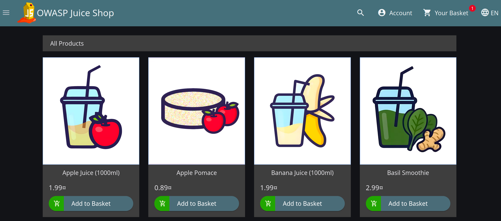
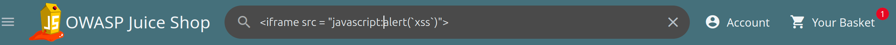

# Security Requirements Document (SRD) & Security Response Plan (SRP)
## Case Study: DOM-Based Cross-Site Scripting (XSS) Remediation

> **DISCLAIMER & ETHICAL STATEMENT**  
> This project is a security analysis study, risk governance framework mapping, and security requirements engineering exercise (GRC Documentation) using **OWASP Juice Shop** (a locally hosted lab environment intentionally designed for educational purposes). This document does not represent security testing conducted on unauthorized or commercial enterprise systems.

---

## 1. Executive Summary

This document outlines the technical security evaluation, risk assessment, **Security Requirements Document (SRD)**, and **Security Response Plan (SRP)** addressing an identified DOM-based Cross-Site Scripting (XSS) vulnerability within the OWASP Juice Shop search functionality.

The primary objective of this documentation is to deliver structured engineering requirements for modern application development teams and establish actionable incident response procedures for security operations center (SOC) personnel.

---

## 2. Risk & Impact Analysis & Risk Treatment Plan

| Parameter | Initial Assessment (Pre-Mitigation) | Post-Mitigation (Residual Risk) |
| :--- | :--- | :--- |
| **Vulnerability** | DOM-based Cross-Site Scripting (CWE-79) | Remediated / Neutralized |
| **CVSS v3.1 Score** | **7.2 (HIGH)** (`CVSS:3.1/AV:N/AC:L/PR:N/UI:R/S:C/C:L/I:L/A:N`) | **0.0 (NONE)** or **1.8 (LOW)** (Context Dependent) |
| **Risk Treatment Strategy** | N/A | **Risk Reduction (Mitigation)** |
| **Risk Owner** | Lead Frontend Engineer / Product Owner | Head of Information Security (Sign-off) |
| **Remediation SLA** | **7 Business Days** (High Severity Standard) | Verified & Closed |

### 2.1 Residual Risk Justification
By enforcing context-aware encoding (`textContent`) and deploying DOMPurify sanitization alongside Content Security Policy (CSP) headers, the attack vector is completely severed. The execution sink no longer evaluates untrusted input as executable script code, reducing the impact and exploitability metrics to zero.

---

## 3. Compliance Framework Mapping

| Standard Framework | Control ID & Name | Strategic Alignment Description |
| :--- | :--- | :--- |
| **ISO/IEC 27001:2022** | **Annex A.8.28** (Secure Coding) | Mandates secure coding practices during software construction to neutralize injection and cross-site scripting vectors. |
| **ISO/IEC 27001:2022** | **Annex A.8.8** (Management of Technical Vulnerabilities) | Establishes formal procedures to evaluate, prioritize, and remediate application security flaws prior to production deployment. |
| **NIST CSF v2.0** | **PR.IR-01** (Infrastructure Resilience / Software) | Enforces rigorous input sanitization and context-aware output encoding mechanisms across application layers. |
| **NIST CSF v2.0** | **RS.AN-01** (Incident Analysis) | Requires root cause analysis during unauthorized client-side DOM code execution events. |

---

## 4. Proof of Concept (PoC) & Execution Evidence

1. **Vulnerability Mechanics**: User inputs supplied to search parameter `q` are rendered directly into the Document Object Model (DOM) without proper context-aware sanitization.
2. **Exploitation Payload**:
```html
<iframe src="javascript:alert(`xss`)">
```
3. **Execution Evidence (Embedded Visuals)**:

   * **Baseline State (Normal Search Application)**:  
     

   * **Triggered State (DOM-based XSS Execution)**:  
     

---

## 5. Security Requirements Document (SRD) & Technical Remediation

Engineering teams must adhere to the following technical security specifications and code implementation standards:

### 5.1 Security Acceptance Criteria
* **SR-01 (Context-Aware Output Encoding)**: Developers shall not use unsafe DOM manipulation properties such as `element.innerHTML`, `document.write()`, or `eval()` for untrusted input handling. Safe DOM text assignment methods like `element.textContent` or `element.innerText` must be enforced.
* **SR-02 (Client-Side Input Sanitization)**: If HTML rendering is required by business logic, untrusted input strings must be passed through a validated sanitization library (e.g., DOMPurify) before binding to DOM elements.
* **SR-03 (Content Security Policy Enforcement)**: The web server must enforce strict CSP HTTP headers restricting unauthorized inline script execution: `Content-Security-Policy: default-src 'self'; script-src 'self'; object-src 'none';`

### 5.2 Technical Code Remediation Snippets
#### A. Vulnerable Code Pattern (Current State)
```javascript
// UNSAFE: Directly evaluating and inserting raw query strings into innerHTML
const urlParams = new URLSearchParams(window.location.search);
const searchQuery = urlParams.get('q');

// Vulnerable DOM sink
document.getElementById('search-result').innerHTML = "Results for: " + searchQuery;

// SECURE: Enforcing textContent to neutralize executable script tags
const urlParams = new URLSearchParams(window.location.search);
const searchQuery = urlParams.get('q');

// Safe DOM sink treating input strictly as literal string
document.getElementById('search-result').textContent = "Results for: " + searchQuery;

// SECURE: Sanitizing input using DOMPurify before HTML rendering
import DOMPurify from 'dompurify';

const urlParams = new URLSearchParams(window.location.search);
const searchQuery = urlParams.get('q');

// Neutralizes malicious tags (<script>, <iframe>) while preserving valid markup
const cleanHTML = DOMPurify.sanitize(searchQuery);
document.getElementById('search-result').innerHTML = "Results for: " + cleanHTML;
```

### 5.3 Automated Security Controls (CI/CD Pipeline Integration)
To prevent regression and enforce proactive security controls (NIST CSF PR.PS-01):
1. **SAST Integration**: Mandatory integration of Static Application Security Testing (e.g., SonarQube, Semgrep, or ESLint Security Rules) within GitHub Actions CI/CD pipelines.
2. **Linting Rules**: Enforce AST rules blocking dangerous DOM sinks (`innerHTML`, `document.write`, `eval`) during pull-request checks.
3. **Build Failure Trigger**: Any pull request introducing unsafe innerHTML assignment without DOMPurify wrapping will automatically fail the build pipeline.
---

---

## 6. Security Response Plan (SRP) - Operational Incident Handling Procedures

When a potential DOM XSS exploitation incident is detected by Security Operations Center (SOC) monitoring systems, the following Incident Response Workflow must be executed:

### Phase 1: Triage & Identification
1. **Log Analysis**: Query Web Application Firewall (WAF) and NGINX/Apache access logs for anomalous GET requests containing search parameters (`q=`) with encoded HTML characters (`%3Cscript%3E`, `%3Ciframe%3E`, `javascript:`).
2. **Impact Assessment**: Analyze client-side application state to identify if hijacked session tokens (`JWT`, `Cookie`, or `localStorage` keys) were exfiltrated during the activity window.

### Phase 2: Containment (Isolation)
1. **WAF Emergency Rule Deployment**: Immediately deploy a temporary WAF regex blocking rule targeting suspicious input vectors on `/search`:

```regex
(?i)(<script|javascript:|document\.cookie|document\.location|localStorage)
```
2. **Session Invalidation**: Issue an automated session revocation command to force re-authentication for all user sessions active during the incident timeframe.

### Phase 3: Eradication & Recovery
1. **Patch Deployment**: Code review and deploy the secure code remediation utilizing `textContent` or `DOMPurify` (as specified in SR-01/SR-02) directly to production environment.
2. **Session Invalidation**: Terminate and invalidate all active user sessions, JWT tokens, and session cookies generated during the breach window to eliminate secondary session hijacking risks.

### Phase 4: Post-Incident Activity (Lessons Learned)
1. **Root Cause Analysis (RCA)**: Conduct a post-mortem technical review to identify why the unsafe DOM manipulation passed the CI/CD static application security testing (SAST) pipelines.
2. **Policy Offloading**: Verify code structural integrity in production, ensure no further XSS anomalies are detected, and gracefully offload the temporary emergency WAF rules.
3. **Risk Register Update**: Record the incident timeline, CVSS severity, and business impact within the Enterprise Risk Register.
4. **Governance & Exception Policy**: If the engineering team cannot meet the **7-Day Remediation SLA** due to critical business blockers, a formal **Risk Acceptance / Exception Request** must be submitted to the Risk Committee. The temporary WAF regex blocking rule will remain active as a *Compensating Control* subject to weekly review.

## About the Author

Ex-Product Manager pivoting into Governance, Risk, and Compliance (GRC). This repository demonstrates the practical application of technical vulnerability research mapped directly to enterprise security controls and compliance frameworks (ISO/IEC 27001 & NIST CSF).
